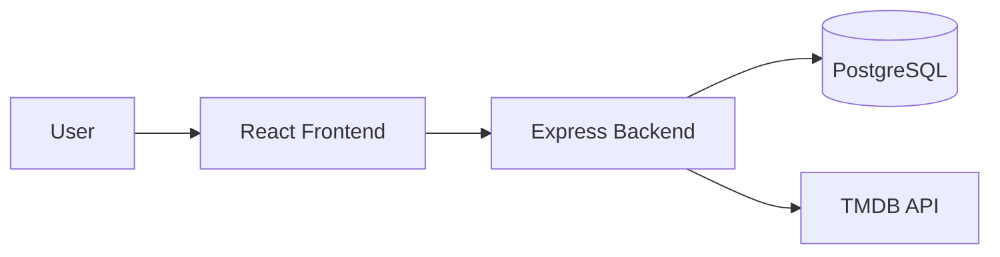
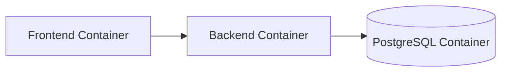
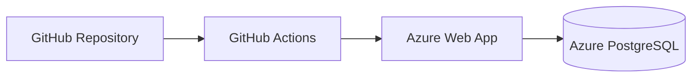
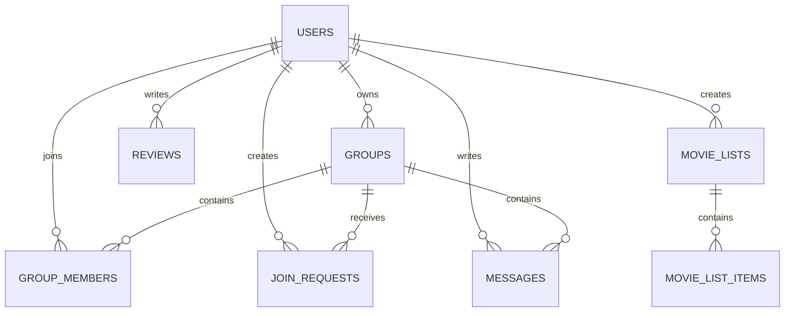
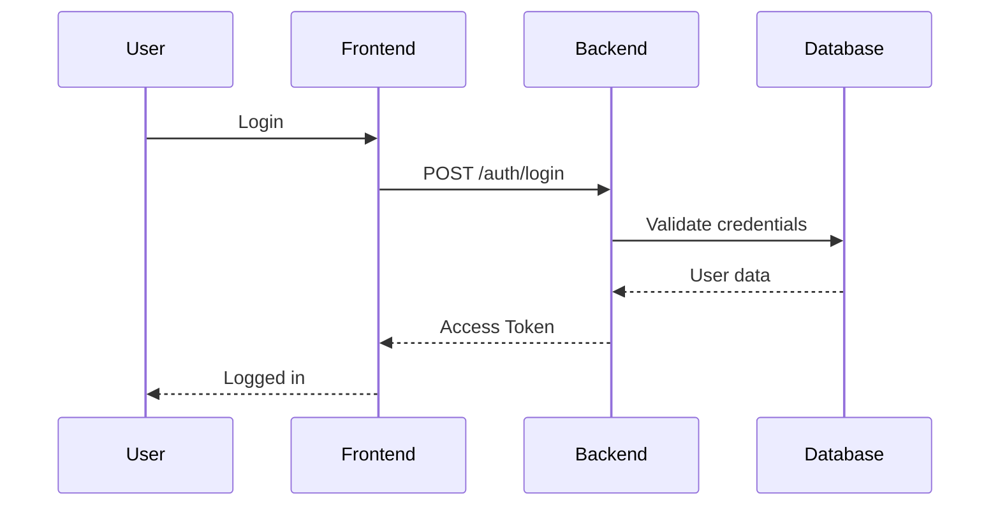
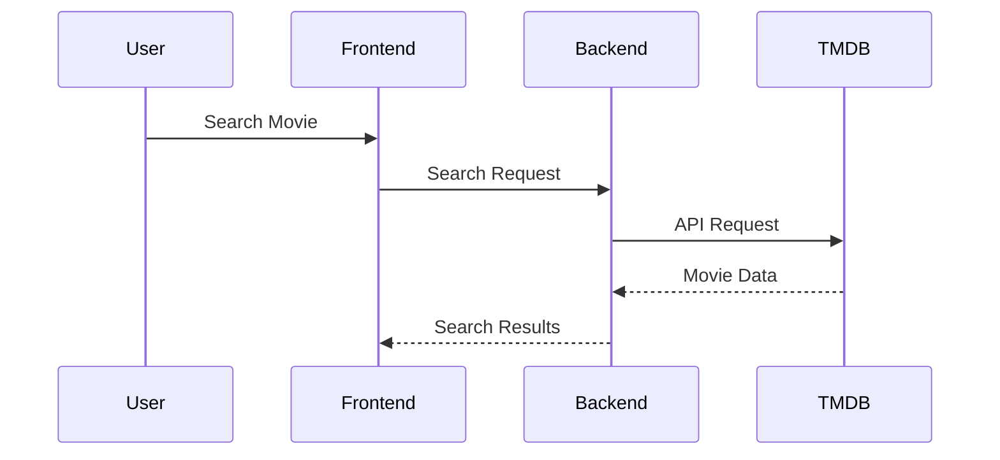

# Technical Specification

| Version | Date | Author | Description |
|----------|----------|----------|----------|
| 1.0 | 2026-11-06 | SG6 Team | Initial technical specification |

## 1. Introduction

### Purpose

This document describes the technical implementation of the Movie Community Application.

The application allows users to:

- Register and log in
- Search movies using TMDB API
- Create movie groups
- Send and manage group join requests
- Write movie reviews
- Create and share movie lists
- Communicate through group chat

### Technology Stack

| Component | Technology |
|------------|------------|
| Frontend | React |
| Backend | Express.js |
| Database | PostgreSQL |
| Authentication | JWT |
| Containerization | Docker |
| CI/CD | GitHub Actions |
| Cloud Platform | Microsoft Azure |
| External API | TMDB API |

---

# 2. System Architecture

## High-Level Architecture



### Architecture Description

The frontend communicates with the Express backend through REST APIs.

The backend is responsible for:

- Authentication
- Authorization
- Business logic
- Database access
- TMDB API integration

PostgreSQL stores all application data while movie metadata is fetched from TMDB.

---

# 3. Development Environment

## Docker Architecture



### Docker Services

#### Frontend

Responsibilities:

- React application
- User interface
- API communication

#### Backend

Responsibilities:

- Express REST API
- Authentication
- Business logic

#### Database

Responsibilities:

- Data persistence
- User management
- Group management
- Reviews
- Chat messages

---

# 4. Deployment Architecture

## Azure Deployment



### Deployment Process

1. Developer pushes changes to main branch.
2. GitHub Actions pipeline executes.
3. Application is built and tested.
4. Application is deployed to Azure Web App.
5. Azure Web App connects to Azure PostgreSQL.

---

# 5. Database Design

## Entity Relationship Diagram



## Main Entities

### Users

Stores registered users.

Key attributes:

- username
- email
- password_hash
- role

### Groups

Stores movie discussion groups.

Key attributes:

- name
- description
- owner_id

### Reviews

Stores reviews written by users.

Key attributes:

- movie_id
- rating
- comment

### Movie Lists

Stores custom movie collections.

### Messages

Stores group chat messages.

---

# 6. Authentication and Authorization

## JWT Authentication Flow



## Authorization

### Roles

| Role | Permissions |
|--------|------------|
| user | Standard application access |
| admin | Administrative actions |

### Protected Endpoints

JWT middleware validates:

- Token signature
- User authorization

---

# 7. Movie Search Integration

## TMDB Integration



### Data Source

Movie information is retrieved from TMDB API and is not permanently stored in the local database.

Only TMDB movie identifiers are stored.

---

# 8. REST API Design

## Authentication

### Register

```http
POST /api/auth/register
```

### Login

```http
POST /api/auth/login
```

### Logout

```http
POST /api/auth/logout
```

---

## Groups

### Create Group

```http
POST /api/groups
```

### Get Groups

```http
GET /api/groups
```

### Join Group

```http
POST /api/groups/:id/join
```

---

## Reviews

### Create Review

```http
POST /api/reviews
```

### Get Reviews

```http
GET /api/reviews
```

---

## Movie Lists

### Create List

```http
POST /api/lists
```

### Get Lists

```http
GET /api/lists
```

---

# 9. Security

## Password Security

Passwords are never stored in plain text.

Passwords are hashed using:

- bcrypt

## Authentication Security

JWT tokens are used for authentication.

Security measures:

- HTTPS connections
- Password hashing

## Database Security

Security practices:

- Parameterized SQL queries
- Environment variables for credentials
- Principle of least privilege

---

# 10. Project Structure

```text
project/

├── api/
│   ├── routes/
│   ├── controllers/
│   ├── middleware/
│   └── init.sql
│
├── src/
│   ├── components/
│   └── pages/
│
├── Dockerfile
├── docker-compose.yml
├── package.json
└── .github/
    └── workflows/
```

---

# 11. Future Development

Potential future enhancements:


- AI-based movie recommendation engine
- International services
- Commercial features